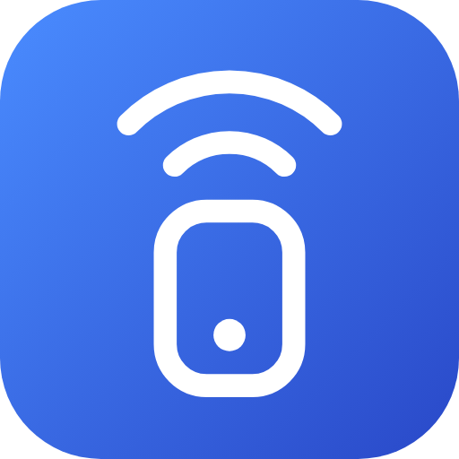

<p align="center"></p>

# homebridge-linksys-velop

[](https://github.com/homebridge/homebridge/wiki/Verified-Plugins)

[](https://paypal.me/orenasher)

Linksys Velop parental controls in Apple Home.

Pause a child's device from the Home app, from Siri or from an automation,
switch its bedtime schedule on or off, and see whether the device is connected.

**Tested on the Linksys Velop MX4200 only.** The plugin talks to the router with the
same local protocol the Linksys app uses (JNAP). Other Velop and Linksys Smart Wi-Fi
models use that protocol too and may work, but none of them has been tested.

- No cloud account. The plugin only talks to the router on your own network.
- No dependencies, and nothing to set up outside Homebridge.
- Pick devices from a list of what is on your network. No MAC addresses to type.
- Works side by side with the Linksys app: a change made in either place shows up in the other.

## What you get in Apple Home

For every device you choose:

| Tile | What it does |
| --- | --- |
| **Pause** switch | On = the device has no internet (the same as *Pause* in the Linksys app). Off = internet is back. |
| **Schedule** switch | On = the device follows its pause schedule, for example "pauses at 22:00". Off = no schedule. A device can have several schedules, each with its own switch. |
| **Connected** sensor | Shows whether the device is connected to the network right now. |

Optionally, a **Restart Router** switch.

## Choosing devices

The settings screen in the Homebridge UI reads the list of devices from the router.

**Devices on your network** shows every device the router knows, each with an icon,
its name, and how it is connected right now: IP address, Wi-Fi band or cable, and the
Velop node it is connected to. Filters at the top show all devices, only the connected
ones, only the ones that are not connected, or only the ones in Apple Home. The search
box looks through names, IP and MAC addresses.

Tap a device to open its details. There you can:

- choose its **icon**,
- turn **In Apple Home** on or off,
- change its **name on the router**,
- keep its IP fixed or release it (see below),
- see its MAC address, maker and connection.

**Parental controls in Apple Home** at the top lists the devices that are in Apple
Home. Each card shows what the router is doing for the device right now (internet on,
paused, or on a schedule) and which tiles it has. Tap a card to:

1. Turn the **Pause switch**, **Schedule switches** and **Connected sensor** on or off.
2. Add schedules with one tap: **Bedtime** (22:00 to 07:00), **School** (08:00 to
   13:00 on school days), **Homework** (16:00 to 18:00), **Dinner** (19:00 to 20:00),
   or **Custom**. Then change the times and days as you like.
3. See the whole week as a chart: red is no internet.

Devices that are already under **Parental Controls** in the Linksys app are added
automatically.

### Icons

Every device gets an icon that the plugin guesses from its name and from what the
device reports about itself: 📱 phones, 📺 TVs, 🎮 consoles, 💡 lights, 🔌 smart plugs,
❄️ air conditioners and so on. To change it, tap the icon (or **Choose icon** in the
device's details) and pick an emoji, or type any emoji you like. **Automatic** goes back
to the guess. Icons are stored in the plugin settings (`icons`).

Icons appear on the settings screen only. Apple Home does not allow emoji in the
names of tiles.

### Renaming devices on the router

The settings screen can also rename devices on the router itself, which is much
quicker than doing it one device at a time in the Linksys app. Open a device, type a
name in **Name on the router** and leave the field. The name is saved on the router
straight away and shows in the Linksys app. Leaving the field empty goes back to the
name the device reports itself.

These are the router's names. The names of the tiles in Apple Home are set
separately, in each device's card.

### Fixed IP addresses

A device's details show a small label next to its address: **fixed IP** when the
router always gives it the same address (a DHCP reservation), **changing IP** when
it does not. 📌 in the list marks the devices with a fixed IP. **Keep this IP** makes
the address the device has right now permanent, and **Release IP** lets it change again.

- A device has to be connected to be given a fixed address, because the address it
  has now is the one that is kept.
- The router stores this list inside its network settings and only accepts the whole
  block at once. The plugin sends everything else back exactly as it read it, and
  reads the list again afterwards to show what the router really stored.
- Taps made close together are written to the router in one go.
- The router labels each reservation with a host-name style name (letters, digits
  and dashes). The plugin derives it from the name the device reports.

**Fixed IP addresses** further down the screen lists every address the router keeps
fixed. It starts with the ones whose device is not connected, or no longer known to
the router at all; the connected ones are one tap away. Release them one by one, or release all the
unconnected ones together. Releasing only frees the address; the device is not
removed. A router cannot tell how long a device has been away, so check the list
before releasing: something that is merely switched off looks the same as something
that is long gone.

### Cleaning up old devices

A router remembers every device it has ever seen, so the list fills up with old
phones, guests and devices that changed their private Wi-Fi address. **Clean up old
devices** lists the ones that are not connected and can be forgotten, and removes
the ticked ones from the router.

- Never offered for removal: devices that are connected, have a fixed IP, are under
  Parental Controls, or are in Apple Home. The router itself also refuses to remove
  a connected device.
- Devices you gave a name are listed but not ticked, so they stay unless you tick them.
- The button asks for a second tap before anything is removed. It cannot be undone,
  but a removed device that connects again simply shows up as a new device.

### One tile or many

By default every device is its own tile in the Home app. If that is too many tiles,
choose **One tile for everything** in the settings: all switches and sensors then
sit inside a single tile, and you open it to reach a single switch.

- Tapping the icon of that tile switches everything in it at once.
- The Restart Router switch always stays a separate tile, so it cannot be hit by accident.
- Changing the layout creates new tiles: rooms, names and automations set in the Home app have to be set again.
- HomeKit allows about 100 switches and sensors in one tile. Give devices fewer tiles if you run into that.

### How Pause and Schedule work together

- Turning **Pause** off puts the device back on whatever schedules are switched on, or fully online if none are.
- Flipping a **Schedule** switch while the device is paused does not lift the pause. It only decides what happens when the pause ends.

### Schedules

There are two ways a device can be scheduled:

- **The schedule from the Linksys app.** If you set no schedules in the plugin, the
  device gets a single **Schedule** switch that turns the schedule from the Linksys
  app on and off. The router forgets that schedule while the device is paused; the
  plugin remembers it and puts it back. A device with no known schedule uses the
  default from the settings (22:00 to 06:00).
- **Schedules set in the plugin.** Add one or more schedules to a device in the
  settings screen, each with a name, a time range and the days it applies to, for
  example "Night" 22:00 to 06:00 every day and "Homework" 16:00 to 18:00 Sunday to
  Thursday. Each one gets its own switch in Apple Home, named after the schedule.
  The internet is blocked whenever any schedule that is switched on blocks it.

Schedules set in the plugin replace the one in the Linksys app for that device: if
the schedule is changed elsewhere, the plugin puts its own back. A pause made in the
Linksys app is always respected. Times are in whole or half hours. A range that
crosses midnight belongs to the day it starts on.

### Ideas for automations

- Pause every console when the last parent leaves home.
- Turn the **Schedule** switch off on Friday evening and back on on Saturday night.
- "Hey Siri, turn on PlayStation Pause."
- Get a notification when a console connects to the network.

## Install

Search for **Linksys Velop** in the Homebridge UI plugin tab, or:

```sh
npm install -g homebridge-linksys-velop
```

Then open the plugin settings and fill in:

- **Router address**: the IP address of the main Velop node (the one connected to the modem). The Linksys app shows it under the node's details; it is usually also your network's gateway address.
- **Router admin password**: the password used to manage the router. This is not the Wi-Fi password and not your Linksys cloud account password.

Tap **Find devices**, open the devices you want and turn on **In Apple Home**, save,
and restart Homebridge.
The settings screen is in English. Hebrew can be chosen from the **Language** menu
at the top of the screen.

## Settings

```json
{
  "platform": "LinksysVelop",
  "name": "Linksys Velop",
  "host": "192.168.1.1",
  "password": "router admin password"
}
```

Everything else is optional:

| Setting | Default | Meaning |
| --- | --- | --- |
| `language` | `"en"` | Language of the settings screen: `"en"` or `"he"` (Hebrew). |
| `autoDiscover` | `true` | Add every device that has a parental-control rule on the router. |
| `grouping` | `"device"` | `"device"`: one tile per device. `"single"`: one tile for everything. |
| `groupName` | plugin name | Name of the single tile. |
| `pauseSwitches`, `scheduleSwitches`, `presenceSensors` | `true` | Which tiles each device gets. |
| `rebootSwitch` | `false` | Add a switch that restarts the router. |
| `pauseSwitchMode` | `"pause"` | `"pause"`: on = internet paused. `"internet"`: on = internet allowed. |
| `presenceSensorType` | `"occupancy"` | `"occupancy"`, `"motion"` or `"contact"`. |
| `defaultPauseStart`, `defaultPauseEnd` | `"22:00"`, `"06:00"` | Used by the single Schedule switch for a device whose schedule is not known yet. Whole or half hours. |
| `devices` | `[]` | See below. |
| `exclude` | `[]` | MAC addresses of devices that should not appear in Apple Home. |
| `labels` | | Words used in the tile names, for example `{ "pause": "Pause", "schedule": "Schedule", "connected": "Connected" }`. Any language works. |
| `pollInterval` | `15` | Seconds between refreshes. |
| `offlineDelay` | `0` | Seconds a device must be gone before it shows as not connected. |
| `syncAppFlags` | `true` | Keep the "Paused" label in the Linksys app in step. |
| `icons` | | Icons on the settings screen, by MAC address, for example `{ "AA:BB:CC:DD:EE:FF": "🎮" }`. Set from the settings screen. |

### The `devices` list

The settings screen writes this list for you. By hand it looks like this:

```json
"devices": [
  {
    "name": "Living room console",
    "macs": ["AA:BB:CC:DD:EE:01", "AA:BB:CC:DD:EE:02"],
    "schedules": [
      { "id": "night", "name": "Night", "start": "22:00", "end": "06:00" },
      { "id": "homework", "name": "Homework", "start": "16:00", "end": "18:00",
        "days": ["sunday", "monday", "tuesday", "wednesday", "thursday"] }
    ]
  },
  {
    "name": "Dad's phone",
    "macs": ["AA:BB:CC:DD:EE:03"],
    "pauseSwitch": false,
    "scheduleSwitch": false
  }
]
```

- **`macs`**: a games console has one MAC address for cable and another for Wi-Fi.
  If only one of them is paused, the child can switch to the other. List both and
  they are paused, resumed and scheduled together. The first address identifies the
  device in Apple Home, so add new addresses after it.
- **`pauseSwitch`, `scheduleSwitch`, `presenceSensor`**: which tiles this device gets.
  With `scheduleSwitch` off, schedules set in the plugin always apply.
- **`schedules`**: see *Schedules* above. `days` left out means every day. `id` keeps
  the switch the same in Apple Home when you rename a schedule.
- A device that is not under Parental Controls yet gets its rule on the router the
  first time it is paused or scheduled. The router allows 14 rules.

## Good to know

- **Phones with a private Wi-Fi address.** iPhones, iPads and Android phones can use
  a random MAC address per network. The router then sees a "new" device and the rule
  no longer matches. Turn off *Private Wi-Fi Address* for your home network on any
  device you want to control.
- **Backups.** The remembered schedules are stored in `linksys-velop.json` in the
  Homebridge storage folder, which is part of a normal Homebridge backup.
- **Renaming.** Rename tiles in the Home app, or change the device name in the plugin
  settings. A name set in the Home app is kept until you change the name in the
  plugin settings again.
- **The router password** is stored in the Homebridge `config.json`, like any other
  plugin credential.
- **This is not an official Linksys API.** A firmware update could change it.
- **Restarting the router** takes the network, and Homebridge's connection to it,
  down for a few minutes. The plugin reconnects by itself.

## Checking the connection without Homebridge

The package includes a small command-line tool:

```sh
node cli.js 192.168.1.1 status
node cli.js 192.168.1.1 pause AA:BB:CC:DD:EE:01
node cli.js 192.168.1.1 resume AA:BB:CC:DD:EE:01 22:00 06:00
```

It asks for the admin password without showing it. `resume` without times removes
every restriction from the device.

## Development

```sh
npm test
```

The tests run the plugin against a mock router and need nothing but Node.js.

## מדריך בעברית

הפלאגין מביא את בקרת ההורים של Linksys Velop ל-Apple Home: השהיית אינטרנט למכשיר,
תזמונים, חיישן שמראה אם המכשיר מחובר, ומתג להפעלה מחדש של הראוטר.
**נבדק על Linksys Velop MX4200 בלבד.**

### התקנה, שלב אחר שלב

1. ב-Homebridge UI, בלשונית התוספים, מחפשים **Linksys Velop** ומתקינים.
2. פותחים את הגדרות הפלאגין. בראש המסך, בתפריט **Language**, בוחרים **עברית**.
3. ממלאים את **כתובת הראוטר** (כתובת ה-IP של הנקודה הראשית) ואת **סיסמת הניהול של הראוטר**. זו לא סיסמת ה-Wi-Fi.
4. לוחצים **מצא מכשירים**.
5. ברשימה **המכשירים ברשת שלך** לוחצים על מכשיר ומפעילים **ב-Apple Home**.
6. לוחצים **שמור** ומפעילים מחדש את Homebridge.

### רשימת המכשירים

- כל מכשיר מופיע עם אייקון, שם, ונקודה ירוקה כשהוא מחובר.
- מתחת לשם: כתובת ה-IP, סוג החיבור (Wi-Fi עם התדר, או כבל), והנקודה שאליה הוא מחובר.
- בראש הרשימה יש סינון: **הכול**, **מחוברים**, **לא מחוברים**, **🏠 בבית** (המכשירים שב-Apple Home).
- 🏠 ליד מכשיר: הוא ב-Apple Home. 📌: יש לו IP קבוע.
- לחיצה על מכשיר פותחת את הפרטים שלו: אייקון, הוספה ל-Apple Home, שם בראוטר, IP קבוע, כתובת MAC ויצרן.

### בחירת אייקון

1. לוחצים על האייקון של המכשיר, או על **בחר אייקון** בפרטים שלו.
2. בוחרים אימוג׳י מהלוח, או מקלידים כל אימוג׳י בתיבה.
3. **אוטומטי** מחזיר את האייקון שהפלאגין ניחש לבד.
4. לוחצים **שמור** למטה.

האייקונים מופיעים רק במסך ההגדרות. Apple Home לא מאפשר אימוג׳י בשמות של אריחים.

### בקרת הורים

בחלק **בקרת הורים ב-Apple Home** יש כרטיס לכל מכשיר. הכרטיס מראה מה הראוטר עושה
עכשיו (יש אינטרנט, מושהה, או לפי תזמון) ואילו מתגים יש למכשיר. לחיצה על הכרטיס:

1. מפעילים או מכבים את **מתג השהיה**, **מתגי תזמון** ו**חיישן מחובר**.
2. מוסיפים תזמון בלחיצה: **שינה** (22:00 עד 07:00), **בית ספר** (08:00 עד 13:00, ימים א׳ עד ה׳), **שיעורי בית** (16:00 עד 18:00), **ארוחת ערב** (19:00 עד 20:00), או **מותאם אישית**.
3. משנים שעות וימים לפי הצורך. כל תזמון מקבל מתג משלו ב-Apple Home.
4. הגרף **השבוע שלך** מראה את כל השבוע: אדום = אין אינטרנט.
5. לוחצים **שמור** ומפעילים מחדש את Homebridge.

### שינוי שם בראוטר ו-IP קבוע

1. לוחצים על מכשיר ברשימה.
2. מקלידים שם ב-**שם בראוטר** ויוצאים מהשדה. השם נשמר מיד בראוטר ומופיע גם באפליקציית Linksys.
3. **קבע את ה-IP** נותן למכשיר תמיד את הכתובת שיש לו עכשיו. **שחרר IP** מבטל את זה.

### ניקוי

- **כתובות IP קבועות**: רשימת כל הכתובות הקבועות, קודם אלה של מכשירים לא מחוברים, כדי למצוא ולשחרר כתובות ישנות.
- **ניקוי מכשירים ישנים**: מחיקה של מכשירים לא מחוברים מרשימת הראוטר. מכשירים מחוברים, עם IP קבוע, בבקרת הורים או ב-Apple Home לא מוצעים למחיקה.

## Thanks

The JNAP calls were worked out with the help of
[uvjim/pyvelop](https://github.com/uvjim/pyvelop), the library behind the
Home Assistant Linksys Velop integration.

## License

MIT

## Support

If this plugin saves you time, you can buy me a coffee: [paypal.me/orenasher](https://paypal.me/orenasher). Thank you!
